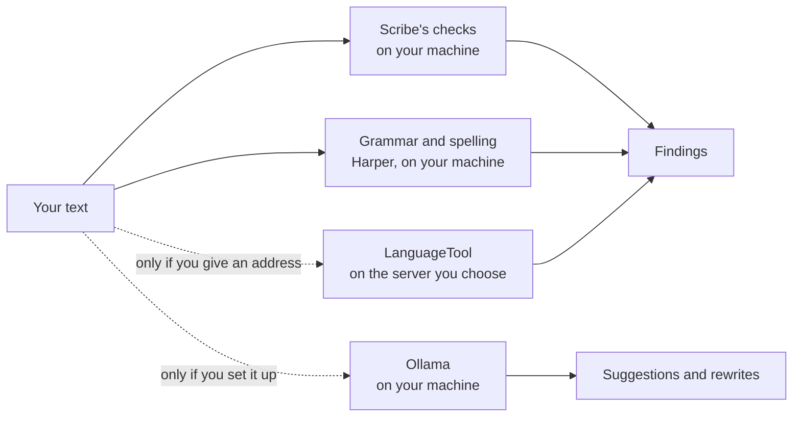

# Scribe

**A writing app that reads what you write, on your own machine.**

Scribe is a desktop app for fiction, scientific reports, email and presentations. As you type,
it points at what could be clearer: a sentence that runs on, a word you lean on, a passive that
hides who acted. Then it offers a fix and waits for you. No account, no subscription and no
model needed: the checks run on your machine and your text stays there. AI help is there if you
want it, through a model you run yourself.

**[Download the latest release](https://github.com/pylvir-labs/scribe-releases/releases/latest)**
· [All releases](https://github.com/pylvir-labs/scribe-releases/releases)
· [Report a problem](https://github.com/pylvir-labs/scribe-releases/issues/new)

## What it does

**It knows what you are writing.** Pick a mode, creative writing, scientific report, email,
presentation or diagram, and the checks follow it. A novel is allowed its em dashes and its
*certain*; a report is not.

**It points, and you decide.** Findings for clarity, style, repetition, fluency and phrasing
that reads as machine-written, each with its reason. A fix shows as a change you read before
you take it, and one Ctrl+Z undoes it. Mute a kind of finding, dismiss one, or add a word to
your dictionary.

**It holds a whole book.** Chapters and parts in a folder you own, a Library of your books on
shelves, and findings across the book: a sentence that repeats one from an earlier chapter, a
word used more often than the book's length can carry.

**A paper comes out right.** Equations in LaTeX notation, figures and tables with numbered
captions, cross-references, citations and a bibliography, typeset to PDF with
[Typst](https://typst.app). A whole book compiles to one PDF with its title page and contents.

**The window gets out of the way.** A centred column at the width you choose, Markdown rendered
as you type, and a quiet surface where the bars fade until you reach for them.

**AI only if you ask for it.** With [Ollama](https://ollama.com) on your machine, Scribe
suggests the next words as you type, rewrites a selection in the tone you pick, and offers
synonyms. Without it, everything above still works.

## Where your text goes

Nothing leaves your machine unless you turn it on. LanguageTool is asked only when you run
*Check grammar & spelling*. The thesaurus downloads its word list the first time you look a word
up, and works offline after that. The update check is off until you turn it on, and sends the
app's name and version, nothing about you or your writing.

## Download

From **[the latest release](https://github.com/pylvir-labs/scribe-releases/releases/latest)**,
take the file for your system:

| Your system | File |
|---|---|
| Windows 10 or 11 | `Scribe_<version>_x64-setup.exe` |
| macOS, Apple Silicon | `Scribe_<version>_aarch64.dmg` |
| macOS, Intel | `Scribe_<version>_x64.dmg` |
| Linux, Debian or Ubuntu | `Scribe_<version>_amd64.deb` |
| Linux, Fedora or openSUSE | `Scribe-<version>-1.x86_64.rpm` |
| Linux, anything else | `Scribe_<version>_amd64.AppImage` |

**0.7.0 is for Windows only, as 0.6.0 and 0.6.1 were.** On Linux or macOS, take
[0.6.2](https://github.com/pylvir-labs/scribe-releases/releases/tag/v0.6.2), the newest release
with files for your system.

The `.msi` is the same Windows app, for those who deploy with Windows Installer. The two
`.app.tar.gz` files are the macOS app without its disk image, and you do not need them.

### The first launch

The installers are not signed, so your system warns you the first time. That is expected.

- **Windows:** on the SmartScreen notice, choose *More info*, then *Run anyway*.
- **macOS:** right-click the app and choose *Open*, then confirm. Or, in a terminal:
  `xattr -dr com.apple.quarantine /Applications/Scribe.app`
- **Linux:** for the AppImage, `chmod +x Scribe_*.AppImage` and run it. The `.deb` and the
  `.rpm` install like any other package.

### Updating

Download the newer installer and run it. Your documents stay where you saved them: Scribe keeps
no copies of its own. Since 0.6.0, *Settings ▸ Updates* tells you when a newer version is out and
opens this page; it never downloads or installs anything by itself. Version 0.5.1 and earlier do
not check: install a newer one by hand once.

## How well each system is tested

| System | Status |
|---|---|
| Windows | Installed and used by the author for every release |
| Linux | Built for 0.6.2. The `.deb` was installed and started under Ubuntu on WSL2, and has had far less use than the Windows build |
| macOS | Built for 0.6.2 and **never run on a Mac**. If it does not start for you, please say so |

## What it needs, and what it does not do

- **Windows** needs the WebView2 runtime, which Windows 10 and 11 have with Edge.
- **The checks and the grammar are for English.** Text in another language is not checked.
- **The AI features need [Ollama](https://ollama.com)** and a model pulled into it. Scribe works
  with a small model and rewrites better with a larger one.
- **The installers are not signed** (see *The first launch*).
- **The source is not public.** This repository holds the installers and the release notes.

## Problems

[Open an issue](https://github.com/pylvir-labs/scribe-releases/issues/new) and say which system
you are on and which version you installed.
